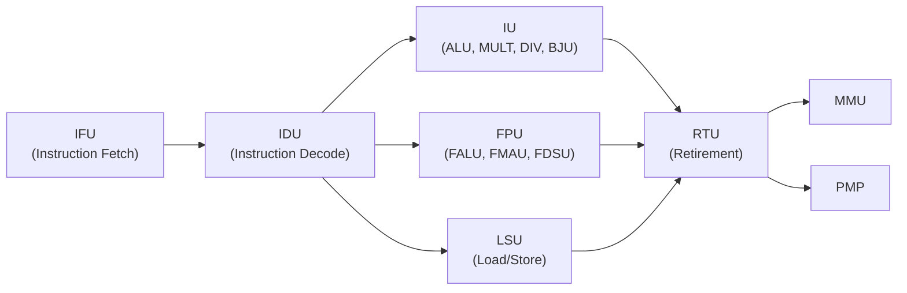
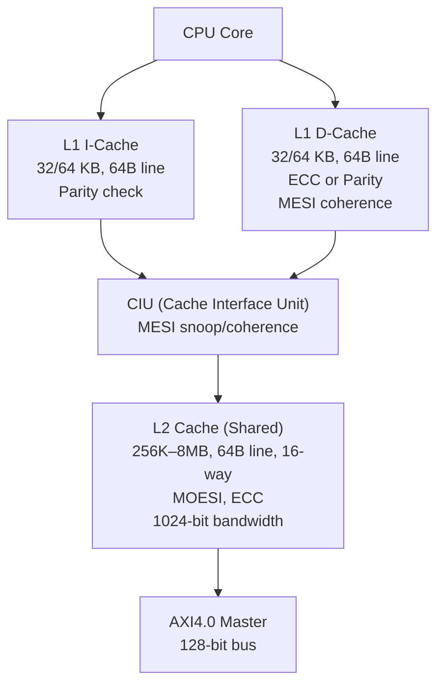
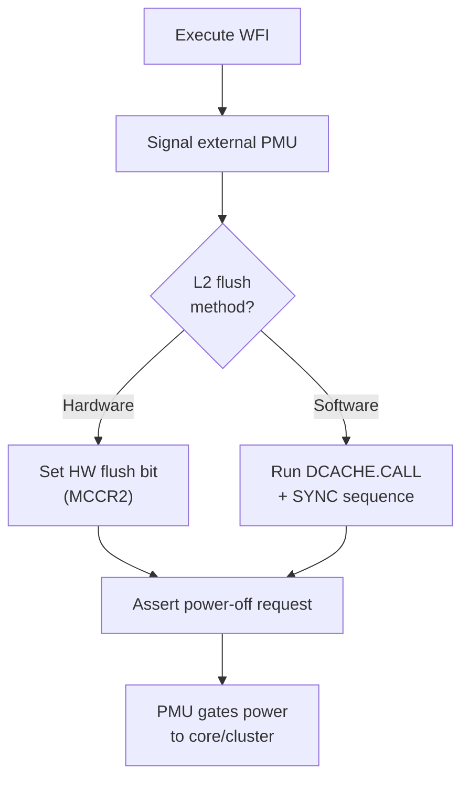

# XuanTie C910 User Manual — Organized Breakdown

> [!NOTE]
> **Document:** `eng_c910.md` — C910 User Manual, Revision 06 (2026-02-12), by C-SKY Microsystems Co., Ltd.  
> **Processor:** XuanTie C910 / C910MP — a 64-bit, high-performance, multi-core RISC-V processor.

---

## 📐 Document Structure at a Glance

```mermaid
flowchart TD
    A["eng_c910.md (~14,700 lines)"]
    A --> B["Ch 1–2: Overview & Architecture"]
    A --> C["Ch 3: Instruction Sets"]
    A --> D["Ch 4: CPU Modes & Registers"]
    A --> E["Ch 5: Exceptions & Interrupts"]
    A --> F["Ch 6: Memory Model"]
    A --> G["Ch 7: Memory Subsystem / Caches"]
    A --> H["Ch 8: Security Design"]
    A --> I["Ch 9: Interrupt Controllers"]
    A --> J["Ch 10: Bus Interface"]
    A --> K["Ch 11: Debug"]
    A --> L["Ch 12: Power Management"]
    A --> M["Ch 13: PMU"]
    A --> N["Ch 14: Program Examples"]
    A --> O["Appendices A–D"]
```

---

## 1 — Overview (Ch 1–2)

### What is C910MP?
The **C910MP** is a 64-bit, high-performance, RISC-V-based multi-core processor from C-SKY Microsystems (XuanTie brand). It targets edge computing: edge servers, machine vision, autonomous driving, 5G base stations, etc.

### Key Architectural Facts

| Feature | Detail |
|---|---|
| ISA | RISC-V 64GC (optionally [V]) |
| Cores | 1–4 configurable homogeneous cores |
| Pipeline | 9–12 stages, deep pipelined |
| Issue / Execute | 3-way issue, **8-way execution** superscalar |
| Execution order | In-order fetch → out-of-order issue → out-of-order complete → **in-order retire** |
| Endianness | Little-endian |
| Cache | Harvard L1, shared L2 |
| FPU | Half-precision (FP16) + Single-precision (FP32) |

### Configurable Options (Table 1.1)

| Unit | Options |
|---|---|
| Number of Cores | 1 / 2 / 3 / 4 |
| DCP (Device Coherence Port) | Yes / No |
| L1 I-Cache | 32 KB / 64 KB |
| L1 D-Cache | 32 KB / 64 KB |
| L1 ECC/Parity | Yes / No (Parity for I$, ECC for D$) |
| L2 Cache | 256K / 512K / 1M / 2M / 4M / **8 MB** |
| L2 ECC | Yes / No |

---

## 2 — CPU Microarchitecture (Ch 2)

The C910 is organized into **in-core** and **multi-core** subsystems.

### In-Core Subsystems

| Unit | Role |
|---|---|
| **IFU** | Fetches up to 8 instructions/cycle; I-Cache way prediction, loop buffers, branch prediction |
| **IDU** | Decodes 3 instructions/cycle; physical register renaming; out-of-order dispatch |
| **IU** | 64-bit ALU, 16×16/32×32/64×64 MULT (4-cycle), base-16 SRT DIV (3–20 cycles), BJU |
| **FPU** | FALU (add/sub/cmp/cvt), FMAU (fused mul-add), FDSU (div/sqrt); FP16 + FP32 |
| **LSU** | Dual-issue scalar load/store; 8-way data prefetch; non-blocking cache access |
| **RTU** | Reorder buffer; 3 retirements/cycle; precise exceptions |
| **MMU** | SV39 standard; 39/48-bit VA → 40-bit PA; software backfill extensions |
| **PMP** | 8/16 entries; 4 KB minimum granularity; no NA4 mode |

### Multi-Core Subsystems

| Unit | Role |
|---|---|
| **CIU** | MESI coherence between L1 D-Caches; 2 snoop buffers; TLB/I-Cache broadcast invalidation |
| **L2 Cache** | Shared; block-based pipeline; 2 accesses/cycle; max 1024-bit bandwidth; configurable latency |
| **AXI Master Interface** | AXI4.0, 128-bit bus; clock ratio 1:1–1:8 |
| **DCP** | AXI4.0 coherence port for DMA peripherals |
| **PLIC** | Up to 1023 external IRQ sources; 32 priority levels; level- and pulse-triggered |
| **Timer** | One shared 64-bit timer; per-core private compare registers |

---

## 3 — Instruction Sets (Ch 3)

The C910 has **two layers** of instruction sets:

### Layer 1: RISC-V Standard ISA

| Extension | Name | Notes |
|---|---|---|
| **RV64I** | Integer Base | ALU, shifts, loads, stores, branches, CSR ops, WFI, MRET/SRET |
| **RV64M** | Multiply/Divide | MUL(4c), DIV(3–20c), REM; 64-bit and 32-bit variants |
| **RV64A** | Atomics | LR/SC, all AMO ops (ADD, AND, OR, XOR, SWAP, MIN, MAX) |
| **RV64F** | Single-Precision FP | FP add/sub/mul/div/sqrt/fma, conversions, comparisons |
| **RV64C** | Compressed (16-bit) | C.ADD, C.LD, C.SW, C.BRANCH, C.FLD, etc. |

### Layer 2: XuanTie Extended ISA

| Group | Purpose | Example Instructions |
|---|---|---|
| **Arithmetic** | MAC, shift-add, conditional-move, rotate | `MULA`, `ADDSL`, `MVEQZ`, `MVNEZ`, `SRRI` |
| **Bit Manipulation** | Extract, find-first, reverse bytes, test | `EXT`, `EXTU`, `FF0`, `FF1`, `REV`, `TST`, `TSTNBZ` |
| **Memory Access** | Register-shift addressing, auto-increment base, dual-register | `LRD`, `LDD`, `LBIA`, `SDD`, `SBIA`, `FLRD`, `FSRD` |
| **Cache Operations** | Clean/invalidate by VA, PA, set/way, broadcast | `DCACHE.CALL`, `DCACHE.CIALL`, `ICACHE.IALL`, `ICACHE.IALLS` |
| **Multi-Core Sync** | Ordering barriers, broadcast invalidation | `SYNC`, `SYNC.I`, `SYNC.IS`, `SYNC.S` |
| **Half-precision FP** | Full FP16 arithmetic suite | `FADD.H`, `FMUL.H`, `FCVT.H.S`, `FLH`, `FSH` |

> [!TIP]
> The XuanTie extended ISA is particularly powerful for SoC firmware: `DCACHE.CIPA` (clean-by-PA) and `ICACHE.IALLS` (broadcast I-cache invalidation) replace the costly software loops needed with plain RISC-V.

---

## 4 — CPU Modes & Registers (Ch 4)

### Privilege Levels
Standard RISC-V: **M-mode** (Machine) > **S-mode** (Supervisor) > **U-mode** (User)

### Register Files

| File | Count | Width |
|---|---|---|
| GPRs (`x0`–`x31`) | 32 | 64-bit |
| FP Registers (`f0`–`f31`) | 32 | 64-bit (FP16/FP32 stored) |

### CSR Banks

**Standard RISC-V CSRs** (Machine, Supervisor, User levels — e.g., `mstatus`, `satp`, `mtvec`, `mepc`, `fcsr`)

**XuanTie Extended CSRs** (C910-specific):

| CSR | Purpose |
|---|---|
| `MXSTATUS` | Extended machine status (FP precision consistency, endian, etc.) |
| `MHCR` | Machine Hardware Config Register (cache enables, prefetch, etc.) |
| `MCOR` | Machine Hardware Operation Register (cache flush triggers) |
| `MCCR2` | L2 Cache Control Register |
| `MCER2` | L2 Cache ECC Control |
| `MHINT` | Implicit Operation Register (hints to hardware) |
| `MRMR` | Machine Reset Register |
| `MRVBR` | Machine Reset Vector Base Address |
| `MCER` | L1 Cache ECC Register |
| `MCOUNTERWEN` | Counter write-enable |
| `MCOUNTERINTEN` | PMU event overflow interrupt enable |
| `MCOUNTEROF` | PMU overflow flag |
| `MEICR` / `MEICR2` | HW error injection (L1/L2 cache testing) |
| `MCINS` / `MCINDEX` / `MCDATA0/1` | Cache access registers (read/write cache contents directly) |
| `MCPUID` | Processor ID |
| `MAPBADDR` | On-chip bus base address |
| `MSMPR` | Snoop Enable Register (multi-core) |

---

## 5 — Exception & Interrupt Handling (Ch 5)

### Exception Flow
1. CPU detects exception → saves `mepc`, `mcause`, `mtval`
2. Jumps to `mtvec` (or delegated to `stvec`)
3. Handler runs; returns with `MRET` / `SRET`

> [!IMPORTANT]
> C910 supports **imprecise exceptions** for certain async faults (e.g., bus errors). The EPC may point past the faulting instruction in these cases.

### Interrupt Priorities (high → low)
`MEI > MSI > MTI > SEI > SSI > STI` (Machine external > software > timer; then Supervisor)

### Interrupt Sources
- **CLINT**: Software interrupts + timer interrupts (per-core)
- **PLIC**: Up to 1023 external interrupts with 32 priority levels

---

## 6 — Memory Model (Ch 6)

### Memory Attributes

| Type | Cacheable | Bufferable | Notes |
|---|---|---|---|
| **Strongly-Ordered** | No | No | MMIO, registers |
| **Weakly-Ordered** | No | Yes | Normal memory, non-cached |
| **Cached** | Yes | Yes | DRAM with cache |

Memory attributes are controlled via:
- **SYSMAP** configuration (hardware signals at boot)
- **MMU page table** attributes (PTE flags)
- **PMP** entries

### MMU (SV39 / SV48)
- Sv39: 3-level page table, 39-bit VA → 40-bit PA
- Supports: 4 KB, 2 MB (mega), 1 GB (giga) pages
- Two-level TLB (L1 TLB + L2 TLB/PTW cache)
- Extended CSRs: `SMCIR`, `SMIR`, `SMEH`, `SMEL` for software TLB management

### PMP (Physical Memory Protection)
- 8 or 16 regions (configurable)
- Minimum granularity: **4 KB**
- Modes: TOR, NAPOT (no NA4)
- Enforced at all privilege levels for all memory accesses

---

## 7 — Memory Subsystem / Cache Hierarchy (Ch 7)

### L1 I-Cache Branch Prediction
| Predictor | Size |
|---|---|
| Branch History Table (BHT) | 64K-entry, 2-level |
| Branch Jump Target Predictor | 1024 or 2048 entries |
| Indirect Branch Predictor | 256 entries |
| Return Address Stack | 12 layers (hardware) |
| Loop Acceleration Buffer | ✓ |
| Fast Jump Target Predictor | ✓ |

### Cache Protection
| Level | Mechanism |
|---|---|
| L1 I-Cache | Parity check |
| L1 D-Cache | ECC (or Parity) |
| L2 Cache TAG | ECC |
| L2 Cache DATA | ECC |

### Accelerated Memory Access
- L1 I-Cache instruction prefetch (hardware auto-detect)
- L1 D-Cache **8-way data stream prefetch** + stride prefetch
- L1 adaptive write-allocation mechanism
- L2 prefetch mechanism

---

## 8 — Security Design (Ch 8)

C910 implements a **Zone-based security model** layered on top of RISC-V privilege modes.

| Feature | Mechanism |
|---|---|
| Secure memory isolation | PMP + IOPMP (I/O Physical Memory Protection) |
| Secure interrupt routing | M-mode controls delegation; per-zone interrupt rules |
| Secure access control | DCP protection attributes |
| Secure debug | Debug access gated by security zone; can be locked |

---

## 9 — Interrupt Controllers (Ch 9)

### CLINT (Core-Local Interrupt Controller)
- **Software interrupts**: via `MSIP` / `SSIP` memory-mapped registers
- **Timer**: Single shared 64-bit `mtime`; each core has `mtimecmp` and `stimecmp`
- Address space: memory-mapped, base configurable

### PLIC (Platform-Level Interrupt Controller)
- Up to **1023** external IRQ sources
- **32 priority levels** (0 = disabled)
- Per-context threshold registers (`PLIC_TH`)
- Claim/Complete registers (`PLIC_CLAIM`)
- Registers: `PLIC_PRIO`, `PLIC_IP`, `PLIC_IE`, `PLIC_CTRL`, `PLIC_TH`, `PLIC_CLAIM`

### Multi-Core Interrupt Scenarios
- Multiple cores responding to external IRQ in parallel
- Cross-core software interrupt (`MSIP` writes from one hart to another)

---

## 10 — Bus Interface (Ch 10)

### AXI4.0 Master Interface
| Property | Value |
|---|---|
| Protocol | AXI4.0 |
| Bus width | 128-bit |
| Read outstanding | Up to 8 |
| Write outstanding | Up to 8 |
| Clock ratio | 1:1, 1:2, 1:3, 1:4, 1:5, 1:6, 1:7, 1:8 |
| Transfer types | INCR bursts; critical-word-first |

ARID/AWID encoding differentiates request types (e.g., instruction fetch vs. data load vs. write-combine).

### DCP (Device Coherence Port)
- Allows **DMA masters** to access L1/L2 D-Cache coherently
- AXI4.0 slave interface
- Hardware-managed cache coherence (MOESI)
- Security attributes enforced

---

## 11 — Debug (Ch 11)

- RISC-V-compatible **external debug interface**
- Supports **halt-mode debug** and **trigger-based breakpoints**
- Multi-core debug framework: single debug port controls all cores
- Debug interface signals include: `dm_cpu_debugack`, `cpu_dm_halted`, `dm_cpu_havereset`, etc.
- PM (probe mode) signals expose CPU run state

---

## 12 — Power Management (Ch 12)

### Low-Power Modes

| Mode | Mechanism |
|---|---|
| Idle (light) | Core WFI — stops clocks for idle units |
| Single-core power-down | Full core power gate; requires state save |
| Cluster power-down | All cores + L2; hardware or software L2 cache flush |

### Power-Down Sequences

Power-related interface signals: `cpu_pad_lpmd_b`, `pad_cpu_pwr_dwn_req`, etc.

---

## 13 — Performance Monitor Unit / PMU (Ch 13)

- **29 hardware event counters** (`mhpmcounter3`–`mhpmcounter31`)
- Plus `mcycle` (cycle counter) and `minstret` (retired instruction counter)
- Per-counter enable/inhibit/overflow-interrupt control
- Accessible from M, S, and U modes (controlled by `mcounteren`/`scounteren`)

### Key PMU Events (sample)
- IFU: fetch stalls, branch mispredicts
- IDU: decode stalls, dispatch stalls
- LSU: D-cache hits/misses, L2 hits/misses, TLB misses
- Execution: integer ops, FP ops, load/store retired

---

## 14 — Program Examples (Ch 14)

Practical "how-to" code sequences for:

| Topic | Summary |
|---|---|
| **Optimal CPU Performance** | Enable caches, prefetch, branch prediction via `MHCR` |
| **MMU Setup** | Configure SATP, write page tables, flush TLB with `SFENCE.VMA` |
| **PMP Setup** | Set `pmpcfg`/`pmpaddr` regions with NAPOT/TOR mode |
| **Cache Enable** | Write `MHCR` to enable L1 I/D caches; `MCCR2` for L2 |
| **I-Cache / D-Cache Sync** | `FENCE.I` + `DCACHE.CIALL` + `SYNC` sequence |
| **TLB + D-Cache Sync** | `SFENCE.VMA` + cache flush |
| **Sync Primitives** | LR/SC spinlock examples, AMO-based atomics |
| **PLIC Setup** | Enable sources, set priority/threshold, handle claim/complete |
| **PMU Setup** | Program `mhpmevent`, enable with `mcountinhibit`, read counters |

---

## Appendices

| Appendix | Contents |
|---|---|
| **Appendix A** | Full instruction-level reference for all standard RV64IMAFDC instructions (encoding, operation, exception behavior) |
| **Appendix B** | Full instruction-level reference for all XuanTie extended instructions (cache ops, sync ops, arithmetic, memory, FP16) |
| **Appendix C** | Complete CSR register bit-field maps (Machine, Supervisor, User levels — standard + extended) |
| **Appendix D** | Multi-core synchronization programming guide: TLB maintenance, I-cache sync, DMA sync, atomic reference implementations |

---

## 🗺️ Quick Navigation Cheat Sheet

| I want to... | Go to |
|---|---|
| Understand the CPU architecture | Ch 2 |
| Look up an instruction | Appendix A (standard) or Appendix B (XuanTie) |
| Configure caches | Ch 7 + Ch 14.4 |
| Set up MMU / page tables | Ch 6.2 + Ch 14.2 |
| Configure PMP memory protection | Ch 6.4 + Ch 14.3 |
| Handle exceptions/interrupts | Ch 5 + Ch 9 |
| Use atomics / multi-core sync | Ch 3.1.3, Appendix D |
| Set up PLIC | Ch 9.2 + Ch 14.6 |
| Profile with PMU | Ch 13 + Ch 14.7 |
| Power down a core or cluster | Ch 12 |
| Look up a CSR bit-field | Appendix C |
| Debug the processor | Ch 11 |

> [!IMPORTANT]
> The document text was **PDF-extracted**, so spacing between words is sometimes collapsed (e.g., `"ThisisaRISC-Vprocessor"`). All content is intact — just cosmetically rough in places.
